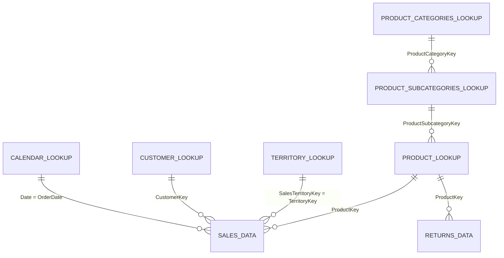

# 🚲 Executive Sales Dashboard: Power BI

An end-to-end Power BI project that analyzes **sales, profit, customers, products and returns** for a global bike and accessories retailer (AdventureWorks data).
It includes data cleaning in Power Query, a star-schema data model, 50+ DAX measures, and interactive features such as a **what-if price slider**, **field parameters**, a **time-intelligence calculation group**, and a **decomposition tree**.

**🔗 Live report:** [[Open in Power BI Service](https://app.powerbi.com/links/4JFN0GLHCX?ctid=5b84a64b-40c9-4879-b7dc-53e04c60e0a5&pbi_source=linkShare)](#) <!-- ✏️ paste your public link -->

---

## 📑 Table of Contents
1. [Project Goal](#-project-goal)
2. [Dashboard at a Glance](#-dashboard-at-a-glance)
3. [Key Insights](#-key-insights)
4. [Dataset](#-dataset)
5. [Tools & Skills](#-tools--skills)
6. [Data Preparation (Power Query)](#-data-preparation-power-query)
7. [Data Model](#-data-model)
8. [Calculated Columns](#-calculated-columns)
9. [DAX Measures](#-dax-measures)
10. [Advanced Features](#-advanced-features)
11. [Report Pages in Detail](#-report-pages-in-detail)
12. [Lessons Learned & Next Steps](#-lessons-learned--next-steps)
13. [Repository Structure](#-repository-structure)

---

## 🎯 Project Goal

Give executives one place to answer:
- How are **revenue, profit and orders** trending, and are we hitting **monthly targets** (+10% vs. the previous month)?
- Which **products and categories** drive sales, and which are **returned** the most?
- Who are our **customers**, and which segments are the most valuable?
- Which **countries and regions** do sales come from?
- What happens to revenue and profit **if we change prices**?

<!-- ✏️ Optional: add who the dashboard is for and why you built it -->

---

## 🖼 Dashboard at a Glance

| Page | Question it answers |
|---|---|
| **1. Executive Overview** | How is the business doing overall, and are we on target? |
| **2. Product Detail** | How do products perform vs. target, and what if prices change? |
| **3. Map** | Where do sales come from? |
| **4. Customer Detail** | Who are our customers and the most valuable ones? |
| **5. Orders Explorer** | What drives total orders? (decomposition tree) |
| **6. Time Intelligence** | How does each subcategory compare with last month, quarter and year? |

Details and screenshots for every page are in [Report Pages in Detail](#-report-pages-in-detail).

---

## 💡 Key Insights

- 📈 **24.9M revenue** and **$10.5M profit** (a margin of about **42%**) from **25.2K orders** and **17K customers**
- 🚀 **Strong growth from mid-2021:** weekly orders jump from under 100 to roughly 400–500 and stay high through 2022
- 🧢 **Accessories lead on orders** (17.0K), ahead of Bikes (13.9K) and Clothing (7.0K). The best-selling product is the **Water Bottle – 30 oz.** (3,983 orders)
- 🔁 **The overall return rate is 2.17%.** The **Sport-100 Helmets** have the highest return rates among the top 10 products (Red 3.33%, Blue 3.31%, Black 2.68%), and **Shorts** is the most returned product type
- 🌍 The **United States** is the top market (8,700 orders), followed by **Australia** (6,060), **Canada** (3,024), the **United Kingdom** (2,771), **France** (2,315) and **Germany** (2,294)
- 👥 Average revenue per customer is **$1.43K**. About **87%** of orders come from low-income customers, and **Professional** (31.5%) and **Skilled Manual** (23.7%) are the largest occupation groups
- 🏆 The top customer is **Mr. Maurice Shan**, with 6 orders and **$12.41K** revenue

---

## 📂 Dataset

| Table | Type | Description |
|---|---|---|
| `Sales Data` | Fact | One row per order line: order date, stock date, order number, product, customer, territory, quantity |
| `Returns Data` | Fact | Return date, territory, product, quantity returned |
| `Product Lookup` | Dimension | Product SKU, name, model, color, style, cost, price |
| `Product Subcategories Lookup` | Dimension | Subcategory names |
| `Product Categories Lookup` | Dimension | Category names (Bikes, Accessories, Clothing) |
| `Customer Lookup` | Dimension | Name, birth date, gender, marital status, income, children, education, occupation, home owner |
| `Territory Lookup` | Dimension | Region, country, continent |
| `Calendar Lookup` | Dimension | Date table: day, week, month, quarter, year |

**Source:** AdventureWorks sample data (CSV files) <!-- ✏️ confirm, e.g. Maven Analytics course files -->
**Period:** Jan 2020 – mid 2022 <!-- ✏️ confirm exact last date -->

---

## 🛠 Tools & Skills

- **Power BI Desktop:** Power Query, data modeling, DAX, report design
- **Power BI Service:** publishing and sharing
- **DAX:** iterators (`SUMX`), filter context (`CALCULATE`, `ALL`, `ALLSELECTED`), time intelligence (`DATESYTD`, `DATEADD`, `DATESINPERIOD`), `INFO.VIEW` functions
- **Modeling:** star schema, snowflaked product hierarchy, dedicated measure table, parameter tables
- **Advanced:** what-if parameter, field parameters, calculation group, SVG image measure, decomposition tree

---

## 🧹 Data Preparation (Power Query)

<!-- ✏️ Confirm or complete these steps from your Applied Steps -->
- Imported the CSV files and promoted headers
- Set data types (dates, whole numbers, currency for `ProductCost` and `ProductPrice`)
- **Customer Lookup:** built `Full Name` from Prefix, First and Last name, and extracted `Domain Name` from `EmailAddress`
- **Product Lookup:** built `SKU Type` from the product SKU
- **Calendar Lookup:** added `Day Name`, `Start of Week`, `Start of Month`, `Start of Quarter`, `Month Name`, `Month`, `Start of Year` and `Year`
- Removed blank and error rows

> 📸 ``

---

## 🧩 Data Model

A **star schema** with two fact tables surrounded by lookup tables. The product dimension is snowflaked (Product → Subcategory → Category). All relationships are **one-to-many with a single filter direction**, from the lookup table to the fact table.



| From (many) | To (one) | Key |
|---|---|---|
| Sales Data | Calendar Lookup | OrderDate → Date |
| Sales Data | Customer Lookup | CustomerKey |
| Sales Data | Territory Lookup | TerritoryKey → SalesTerritoryKey |
| Sales Data | Product Lookup | ProductKey |
| Returns Data | Product Lookup | ProductKey |
| Product Lookup | Product Subcategories Lookup | ProductSubcategoryKey |
| Product Subcategories Lookup | Product Categories Lookup | ProductCategoryKey |

**Supporting tables (not related to the model, on purpose):**

| Table | Purpose |
|---|---|
| `Measure Table` | Holds all core measures in one place |
| `Price Adjustment (%)` | What-if parameter: `GENERATESERIES(-1, 1, 0.1)` (−100% to +100%) |
| `Product Metric Selection` | Field parameter: Orders / Revenue / Profits / Returns / Return % |
| `Customer Metric Selection` | Field parameter: Customers / Revenue per Customer |
| `Measure Selector` | Field parameter: Revenue / Cost / Profits / Orders / Quantity Sold |
| `Time Intelligence` | Calculation group |
| `Model tables`, `Model Columns` | Self-documentation built with `INFO.VIEW.TABLES()` and `INFO.VIEW.COLUMNS()` |

> 📸 ``

---

## 🧮 Calculated Columns

| Table | Column | Logic |
|---|---|---|
| Customer Lookup | `Parent` | `"Yes"` if TotalChildren > 0 |
| Customer Lookup | `Customer Priority` | `"Priority"` if parent **and** income > 100,000 |
| Customer Lookup | `Income Level` | Very High ≥ 150k, High ≥ 100k, otherwise Low |
| Customer Lookup | `Education Category` | Groups education levels into High School / Undergrad / Graduate |
| Customer Lookup | `Customer Full Name (CC)` | Prefix & First name & Last name |
| Customer Lookup | `Birth Year`, `Age` | `YEAR(BirthDate)`, `YEAR(TODAY()) - Birth Year` |
| Product Lookup | `Price Point` | High > 500, Mid-Range > 100, otherwise Low |
| Calendar Lookup | `Month Short` | First 3 letters of the month name |
| Calendar Lookup | `Month Number (DAX)` | `SWITCH` on month name |
| Calendar Lookup | `day of week`, `Weekend` | `WEEKDAY(Date, 2)`: Weekend if 6 or 7 |
| Sales Data | `Quantity Type` | `"Multiple Items"` if OrderQuantity > 1 |


*These columns slice the orders in the income and occupation donut charts.*

<details>
<summary>Example: Customer Priority</summary>

```dax
Customer Priority =
IF(
    'Customer Lookup'[Parent] = "Yes" &&
    'Customer Lookup'[AnnualIncome] > 100000,
    "Priority",
    "Standard"
)
```
</details>

---

## 📐 DAX Measures

### Core KPIs


*The headline cards use `Total Revenue`, `Total profits`, `Return Rate` and `Total Orders`, with last-month and target comparisons.*

| Measure | DAX |
|---|---|
| Total Revenue | `SUMX('Sales Data', 'Sales Data'[OrderQuantity] * RELATED('Product Lookup'[ProductPrice]))` |
| Total Cost | `SUMX('Sales Data', 'Sales Data'[OrderQuantity] * RELATED('Product Lookup'[ProductCost]))` |
| Total Profit | `[Total Revenue] - [Total cost]` |
| Total Orders | `DISTINCTCOUNT('Sales Data'[OrderNumber])` |
| Total Customers | `DISTINCTCOUNT('Sales Data'[CustomerKey])` |
| Quantity Sold | `SUM('Sales Data'[OrderQuantity])` |
| Total Returns | `SUM('Returns Data'[ReturnQuantity])` |
| Return Rate | `[Quantity Returned] / [Quantity Sold]` |
| Average Retail Price | `AVERAGE('Product Lookup'[ProductPrice])` |

### Ratios & Efficiency


*Orders, revenue and `Return Rate` side by side, with a red conditional-formatting scale on Return %.*

| Measure | Logic |
|---|---|
| Profit Margin % | Profit ÷ Revenue |
| Average Order Value | Revenue ÷ Orders |
| Revenue per Customer | Revenue ÷ Customers |
| Profit per Customer | Profit ÷ Customers |
| Average Units per Order | Quantity ÷ Orders |
| High Ticket Orders / % | Orders for products priced above 714.44 (the average price), and their share of all orders |

### Share of Total (filter context)


*Category share of orders is the type of view that the `% of …` measures are built for.*

| Measure | Technique |
|---|---|
| All Orders, All Returns | `CALCULATE(..., ALL(table))`: ignores all filters |
| % of All Orders / Returns / Total Revenue | Measure ÷ its `ALL()` version |
| % of Total Orders / Returns / Profit | Measure ÷ its `ALLSELECTED()` version: respects slicers |
| Overall Average Price | `CALCULATE([Average Retail Price], ALL('Product Lookup'))` |

### Category Focus: Bikes
`Bike Sales`, `Bike Returns`, `Bike Return Rate`: `CALCULATE([measure], 'Product Categories Lookup'[CategoryName] = "Bikes")`

### Time Intelligence & Targets


*Monthly cards compare with the previous month (`Previous Month …`, `… Growth %`).*


*Gauges use the `… Target` measures (previous month × 1.1) as the target marker.*

| Measure | DAX / Logic |
|---|---|
| YTD Revenue | `CALCULATE([Total Revenue], DATESYTD('Calendar Lookup'[Date]))` |
| Previous Month Revenue / Orders / Profit / Returns | `CALCULATE([measure], DATEADD('Calendar Lookup'[Date], -1, MONTH))` |
| 10-day Rolling Revenue | `CALCULATE([Total Revenue], DATESINPERIOD('Calendar Lookup'[Date], MAX('Calendar Lookup'[Date]), -10, DAY))` |
| Revenue / Order / Profit Target | Previous month × 1.1 (a **+10% growth goal**) |
| Target Gap | Actual − Target |
| Target Achievement % | Actual ÷ Target |
| Profit Growth %, Orders Growth % | (Current − Previous Month) ÷ Previous Month |

### Customer Detail (drill-through)


*When one customer is in context, the `(Customer Detail)` measures show their name, orders and revenue.*

These measures return a value only when **one** customer is in context, and a fallback otherwise:

```dax
Full Name (Customer Detail) =
IF(
    HASONEVALUE('Customer Lookup'[CustomerKey]),
    MAX('Customer Lookup'[Full Name]),
    "Multiple Customers"
)
```
Also: `Total Orders (Customer Detail)` and `Total Revenue (Customer Detail)`.

---

## ✨ Advanced Features

### 1. What-If Analysis: Price Adjustment


*Moving the slider changes `Adjusted Profits` compared with the actual `Total profits`.*

A slider from −100% to +100% simulates price changes:

```dax
Price Adjustment (%) = GENERATESERIES(-1, 1, 0.1)
Price Adjustment (%) Value = SELECTEDVALUE('Price Adjustment (%)'[Price Adjustment (%)], 0)

Adjusted Price   = [Average Retail Price] * (1 + 'Price Adjustment (%)'[Price Adjustment (%) Value])
Adjusted Revenue = SUMX('Sales Data', 'Sales Data'[OrderQuantity] * [Adjusted Price])
Adjusted Profits = [Adjusted Revenue] - [Total cost]
```

### 2. Field Parameters: Dynamic Metric Switching

 


Users choose which metric a visual shows, with no duplicate visuals:

```dax
Product Metric Selection = {
    ("Orders",   NAMEOF('Measure Table'[Total Orders]),  0),
    ("Revenue",  NAMEOF('Measure Table'[Total Revenue]), 1),
    ("Profits",  NAMEOF('Measure Table'[Total profits]), 2),
    ("Returns",  NAMEOF('Measure Table'[Total Returns]), 3),
    ("Return %", NAMEOF('Measure Table'[Return Rate]),   4)
}
```
The same pattern is used for `Customer Metric Selection` and `Measure Selector`.

### 3. Calculation Group: Time Intelligence


One set of time calculations that applies to **any** measure, instead of a YTD or previous-month version of every measure. The calculation items are **Current Measure, Previous Month, MOM, MOM %, QTD and YTD**. Together with the `Measure Selector` field parameter, users pick a measure and see all the time calculations at once.

### 4. SVG Sparkline Measure
A DAX measure builds an **SVG image** (line, gradient area and end-point marker) of monthly revenue. Set the field's *Data category* to *Image URL* and use it in a table or card.

<!-- ✏️ Add a screenshot of the visual where you use it -->

<details>
<summary>Show full DAX</summary>

```dax
Revenue Sparkline =
VAR LineColour = "%23118DFF"
VAR PointColour = "white"
VAR Defs =
    "<defs><linearGradient id='grad' x1='0' y1='25' x2='0' y2='50' gradientUnits='userSpaceOnUse'>
        <stop stop-color='#118DFF' offset='0' />
        <stop stop-color='#118DFF' offset='0.3' />
        <stop stop-color='white' offset='1' />
     </linearGradient></defs>"
VAR XMinDate = MIN('Calendar Lookup'[Start of Month])
VAR XMaxDate = MAX('Calendar Lookup'[Start of Month])
VAR YMinValue = MINX(VALUES('Calendar Lookup'[Start of Month]), CALCULATE([Total Revenue]))
VAR YMaxValue = MAXX(VALUES('Calendar Lookup'[Start of Month]), CALCULATE([Total Revenue]))
VAR SparklineTable =
    ADDCOLUMNS(
        SUMMARIZE('Calendar Lookup', 'Calendar Lookup'[Start of Month]),
        "X", INT(150 * DIVIDE('Calendar Lookup'[Start of Month] - XMinDate, XMaxDate - XMinDate)),
        "Y", INT(50 * DIVIDE(CALCULATE([Total Revenue]) - YMinValue, YMaxValue - YMinValue))
    )
VAR Lines =
    CONCATENATEX(SparklineTable, [X] & "," & (50 - [Y]), " ", 'Calendar Lookup'[Start of Month], ASC)
VAR LastSparkYValue = MAXX(FILTER(SparklineTable, 'Calendar Lookup'[Start of Month] = XMaxDate), [Y])
VAR LastSparkXValue = MAXX(FILTER(SparklineTable, 'Calendar Lookup'[Start of Month] = XMaxDate), [X])
VAR SVGImageURL =
    "data:image/svg+xml;utf8," &
    "<svg xmlns='http://www.w3.org/2000/svg' x='0px' y='0px' viewBox='-7 -7 164 64'>" & Defs &
    "<polyline fill='url(#grad)' fill-opacity='0.3' stroke='transparent' stroke-width='0' points='0 50 " & Lines & " 150 50 Z' />" &
    "<polyline fill='transparent' stroke='" & LineColour & "' stroke-linecap='round' stroke-linejoin='round' stroke-width='3' points='" & Lines & "' />" &
    "<circle cx='" & LastSparkXValue & "' cy='" & (50 - LastSparkYValue) & "' r='4' stroke='" & LineColour & "' stroke-width='3' fill='" & PointColour & "' />" &
    "</svg>"
RETURN SVGImageURL
```
</details>

### 5. Self-Documenting Model
Calculated tables built with `INFO.VIEW.TABLES()` and `INFO.VIEW.COLUMNS()` list the model's own metadata, which makes documentation like this README easy to keep up to date.

---

## 📊 Report Pages in Detail

A navigation bar on the left links the pages (Executive, Map, Products, Customers), with back and filter buttons.

### 1. Executive Overview
*How is the business performing overall, and are we on target?*

- **KPI cards:** Total Revenue (24.9M), Total Profit ($10.5M), Return Rate (2.17%) and Total Orders (25.2K), each with last-month and target comparisons
- **Weekly Orders vs Weekly Revenue:** dual-axis line chart (2020–2022) with a date range slider
- **Total Orders by Category:** Accessories, Bikes, Clothing
- **Top 10 Products:** orders, revenue, and Return % with a red color scale
- **Monthly KPI cards with sparklines:** revenue, orders, profit, returns
- **Most Ordered / Most Returned Product Type** cards


### 2. Product Detail
*How does a product perform vs. target, and what happens if we change prices?*

- **Gauges:** monthly orders, revenue and profit vs. target (last month + 10%)
- **Price Adjustment (%) slider:** the what-if parameter that drives **Adjusted Profits** in the *Weekly Profits* chart
- **Product Metric Selection:** a field-parameter radio list that switches the area chart
- **Selected Product** card


### 3. Map
*Where do sales come from?*

- Bubble map sized by sales: the **United States** is the largest market, followed by Australia, Canada, the United Kingdom, France and Germany
- Region buttons (Select all / Europe / North America / Pacific) filter the map


### 4. Customer Detail
*Who are our customers, and which are the most valuable?*

- **Customer Metric Selection** buttons (Customers / Revenue per Customer) switch the weekly trend line
- **Cards:** 17K Total Customers and $1.43K Revenue per Customer
- **Orders by Income Level** (Low 86.89%, High 11.24%) and **Orders by Occupation** donuts
- **Top 100 Customers** table with a revenue color scale
- **Top Customer (by Revenue):** Mr. Maurice Shan, 6 orders, $12.41K
- Year range slider (2020–2022) and a customer name list


### 5. Orders Explorer (Decomposition Tree)
*What drives total orders?*

A decomposition tree splits **Total Orders (25,164)** step by step: Country → Product → Category → Subcategory. Users choose the path themselves, or let Power BI pick the next best split (the 💡 levels). The example path: United Kingdom → Sport-100 Helmet, Blue → Accessories → Helmets. Summary cards show Total Orders, Total Profits, Total Customers and Total Returns.


### 6. Time Intelligence
*How does each subcategory compare with last month, this quarter and this year?*

A matrix by subcategory, driven by the **Time Intelligence calculation group**:

| Column | Meaning |
|---|---|
| Current Measure | The selected measure for the current period |
| Previous Month | The same measure one month earlier |
| MOM | Month-over-month change |
| MOM % | Month-over-month change in % |
| QTD | Quarter to date |
| YTD | Year to date |

The **Measure Selector** (Total Revenue / Total cost / Total profits / Total Orders / Quantity Sold) changes which measure every column uses. Rows expand by year (for example Mountain Bikes → 2020, 2021, 2022).


---

## 🧠 Lessons Learned & Next Steps

- A dedicated **Measure Table** keeps the model easy to navigate
- **Field parameters** and **calculation groups** reduce the number of visuals and measures a lot
- `ALL()` and `ALLSELECTED()` give different "share of total" results, so choose based on whether slicers should apply

**Planned improvements**
- Convert `Returns Data[ReturnDate]` from text to date and relate it to `Calendar Lookup` and `Territory Lookup`, so returns can be analyzed over time and by region
- Use one currency format across all measures (the report mixes £ and $)
- Fix the `Income Level` column logic so the "Average" band can be reached
- Replace the hard-coded high-ticket threshold (714.44) with a dynamic average
- Use `DIVIDE` in `Return Rate` to avoid divide-by-zero errors
- Add row-level security by region

---

## 📁 Repository Structure

```
├── Executive-Sales-Dashboard.pbix
├── data/                 # source CSV files
├── images/               # page screenshots used in this README
│   └── sections/         # cropped visuals for each feature
└── README.md
```

---

## 👤 Author

**[[Abdulbari Soliman]]** · [[LinkedIn](https://www.linkedin.com/in/abdulbari-soilman/)](#) · [[Portfolio](https://github.com/AbdulbariSoliman)](#)
